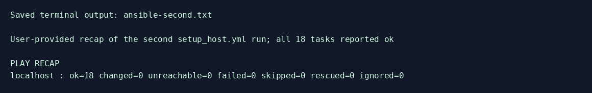
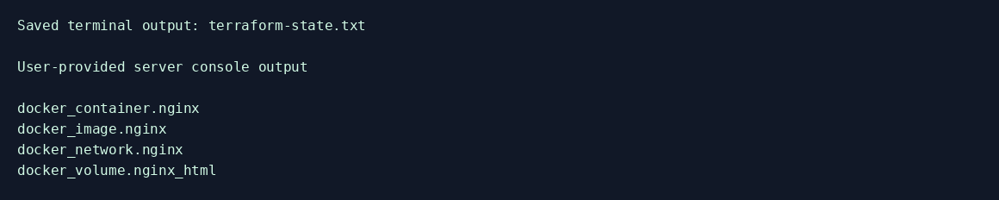
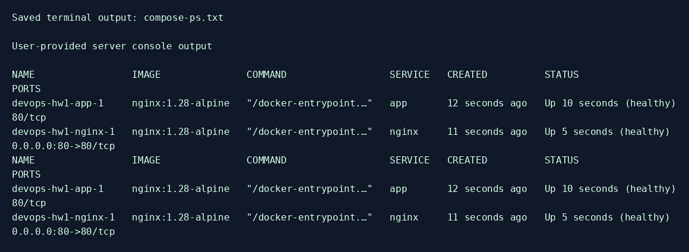
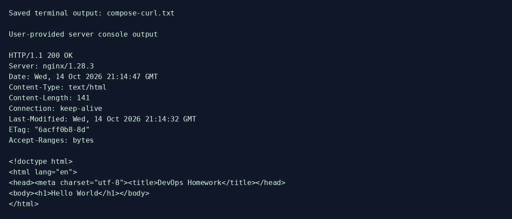
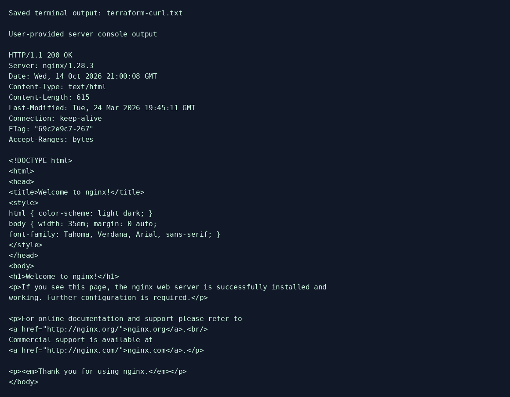
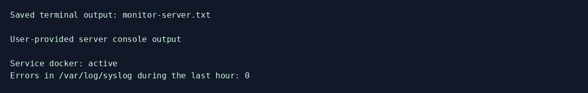
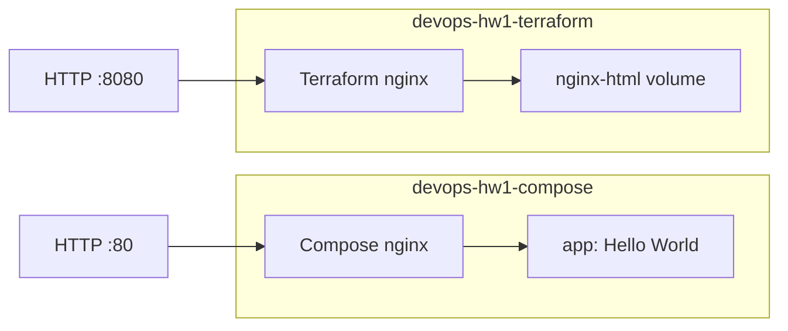

# ДЗ №1: фундамент DevOps-инфраструктуры

Киреев Дмитрий Владимирович, `kireevdv`. Сервер: Ubuntu 24.04.4, `111.88.162.109`.

Выполнено с учётом `task`: сначала Ansible, затем Terraform с `kreuzwerker/docker`. Terraform создаёт nginx на порту **8080**, отдельную сеть и именованный том. Два Compose-сервиса работают в другой сети; reverse proxy на порту **80** возвращает **Hello World**.

## Подтверждённые результаты

| Проверка | Результат |
|---|---|
| Первый Ansible setup | `ok=20 changed=10 failed=0` |
| Второй Ansible setup | `ok=18 changed=0 failed=0` |
| Terraform validate/apply | Конфигурация валидна, 4 ресурса созданы |
| Terraform state | Контейнер, образ, сеть и том учтены |
| Повторный Terraform plan | `No changes`, проверено ассистентом через SSH от deployer |
| HTTP :8080 | `200 OK`, Welcome to nginx |
| HTTP :80 | `200 OK`, Hello World |
| Compose и Terraform контейнеры | Все три `healthy` |
| Сети и том | `PASS: services healthy, networks separated, named volume attached` |
| Мониторинг сервера | Docker active, 0 ошибок в syslog за час |
| HTTP извне | Порты 80 и 8080 проверены ассистентом, оба `200 OK` |

Полные серверные выводы предоставлены пользователем и сохранены в [evidence/terraform-server.txt](evidence/terraform-server.txt) и [evidence/compose-server.txt](evidence/compose-server.txt). Для Ansible сохранены переданные recap; полного первого вывода нет. Изображения ниже — PNG-представления сохранённых фактических выводов команд, не захваты рабочего стола.

### Ansible: второй запуск



### Terraform state list



### Docker Compose и HTTP





### Мониторинг



## Архитектура



Terraform nginx присоединён только к `devops-hw1-terraform`; именованный том `devops-hw1-nginx-html` подключён в `/usr/share/nginx/html` для чтения. Docker заполняет новый пустой том стандартной страницей из образа. Compose nginx и app присоединены только к `devops-hw1-compose`; app не публикует внешний порт. Это подтверждено `docker inspect` и [проверкой сетей](evidence/networks.txt).

Выданная VM уже существует. Уточнение заменяет облачную часть Terraform Docker-ресурсами; облачные VM, VPC, Security Group и IAM не создаются. Ansible создаёт локального пользователя `deployer`, настраивает ключевой SSH, Docker и sudo без пароля согласно PDF. Docker-группа и полный sudo дают административные полномочия; это учебные требования. Docker API доступен через локальный socket либо SSH.

## Структура

- `terraform/`: main.tf, переменные, outputs, Docker provider и lock file.
- `ansible/`: удалённый и локальный inventory, setup_host.yml, deploy_app.yml, роль host_setup.
- `compose/`: два сервиса, конфигурация reverse proxy, HTML Hello World.
- `scripts/`: мониторинг, проверки, bootstrap, сбор и изображения выводов.
- `evidence/`, `screenshots/`: фактические результаты; первоначальные blockers.txt относятся к началу работы.
- `docs/`: само-ревью и описание PR.

Пароли, приватные ключи, Terraform state и локальные tfvars исключены из Git. State текущего развёртывания хранится на сервере в `/opt/devops-hw1-terraform/terraform.tfstate`; операции выполняются от его владельца `deployer`.

## Запуск на сервере

Поддерживается Ubuntu 22.04+; локальный контроллер из requirements.txt требует Python 3.11+. На проверенном сервере используется Python 3.12.3. Первоначальный доступ — `student` с sudo.

```bash
git clone https://github.com/jaruccky/devops-homework.git
cd devops-homework
bash scripts/server_info.sh
bash scripts/setup_local.sh
```

`setup_local.sh` устанавливает venv/Ansible, создаёт отдельный ключ `~/.ssh/devops_homework`, запускает настройку дважды и проверяет `changed=0`. Ключ остаётся вне Git, конфигурация student SSH сохраняется. Логи автоматического запуска записываются в игнорируемый `evidence/server/`, поэтому не мешают `git pull --ff-only`.

### Terraform

HashiCorp download и registry были недоступны с сервера; использованы зеркала Yandex Cloud. Это источники скачивания, провайдер остаётся `kreuzwerker/docker`.

```bash
sudo apt-get install -y unzip
curl -fL https://hashicorp-releases.yandexcloud.net/terraform/1.13.3/terraform_1.13.3_linux_amd64.zip -o /tmp/devops-terraform.zip &&
sudo unzip -o /tmp/devops-terraform.zip terraform -d /usr/local/bin

sudo install -d -o deployer -g deployer /opt/devops-hw1-terraform
sudo cp terraform/*.tf /opt/devops-hw1-terraform/
sudo chown deployer:deployer /opt/devops-hw1-terraform/*.tf
sudo install -o deployer -g deployer -m 0644 terraform/.terraform.lock.hcl /opt/devops-hw1-terraform/.terraform.lock.hcl
sudo install -o deployer -g deployer -m 0644 terraform/terraform.local.tfvars.example /opt/devops-hw1-terraform/terraform.tfvars
sudo install -o deployer -g deployer -m 0644 terraform/terraformrc.mirror.example /opt/devops-hw1-terraform/terraform.rc

tf() {
  sudo -H -u deployer env TF_CLI_CONFIG_FILE=/opt/devops-hw1-terraform/terraform.rc \
    terraform -chdir=/opt/devops-hw1-terraform "$@"
}
tf init
tf validate
tf plan -out=homework.tfplan
tf apply homework.tfplan
tf state list
tf plan -detailed-exitcode
curl --fail -i http://127.0.0.1:8080/
```

Повторный план должен вернуть код 0; код 2 означает изменения, 1 — ошибку. Запуск от student выдаст permission denied при чтении state: используйте функцию tf выше. Lock file фиксирует Docker provider 3.9.0 и checksum для linux_amd64, архитектуры проверенного сервера. Для другой платформы необходимо сформировать дополнительные checksums.

### Compose и проверки

```bash
(cd ansible && ../.venv/bin/ansible-playbook -i inventory.local.ini deploy_app.yml -K)
sudo docker compose -f /opt/app/docker-compose.yml ps
sudo -H -u deployer bash -s < scripts/verify_remote.sh
sudo /usr/local/bin/monitor.sh docker
./scripts/verify.sh 111.88.162.109
```

Playbook копирует проект в `/opt/app` и вызывает `docker compose up -d --wait`. Прокси использует Docker DNS для app; повторное разрешение имени позволяет пережить пересоздание backend. Healthcheck и restart policy настроены у всех трёх контейнеров.

## Мониторинг и локальные проверки

`monitor.sh SERVICE` проверяет `systemctl is-active`, при неактивном сервисе выводит последние 10 строк journalctl. Ошибки syslog за последний час считает через grep/awk, поддерживает RFC3164, ISO timestamps, часовые пояса и смену года. При отсутствии syslog используется journald; недоступные журналы дают ошибку, а не нулевой счётчик.

Коды: 0 — активен и логи прочитаны; 1 — неактивен/неизвестен; 2 — неверный вызов либо ошибка окружения. На локальной машине скрипт также запускался: [вывод](evidence/monitor-local.txt). Десять тестов покрывают подсчёт и ошибки.

```bash
python3 -m venv .venv
.venv/bin/python -m pip install -r requirements.txt
./scripts/validate.sh
```

[Отчёт проверок](evidence/validation.txt). Terraform fmt/init/validate в validate.sh выполняются при наличии бинарника; первоначальная локальная проверка ограничивалась HCL parse, затем validate/apply подтверждены на сервере.

## Git workflow и архитектурные решения

Рабочая ветка — `feature/infra-setup`, [PR #1](https://github.com/jaruccky/devops-homework/pull/1), само-ревью — [docs/self-review.md](docs/self-review.md). Итоговая версия — `v0.1.0` после merge в main.

Сеть Terraform отделена от Compose согласно уточнению; наружу публикуются только предусмотренные HTTP-порты, backend доступен через внутреннюю сеть. Именованный том сохраняет страницу при пересоздании контейнера. Локальный режим Ansible/Terraform позволил выполнить настройку через серверную сессию, пока прямой SSH ассистента был недоступен. Ошибка доступа к registry устранена явным TF_CLI_CONFIG_FILE, ошибка state permission — запуском от deployer. В конце ассистент также подключился по SSH, подтвердил пустой повторный план и оба HTTP-порта извне.
