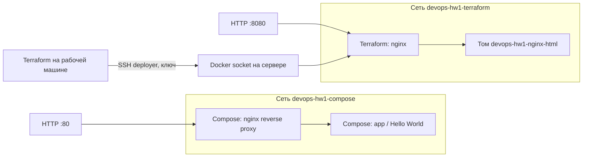

# ДЗ №1: фундамент DevOps-инфраструктуры

Киреев Дмитрий Владимирович, `kireevdv`.

Решение учитывает дополнение из `task`: **сначала Ansible, затем Terraform с провайдером `kreuzwerker/docker`**. Сервер уже выдан: `111.88.162.109`, начальный пользователь `student`.

## Текущий результат

Код подготовлен; локально проверены синтаксис Ansible, Docker Compose, HCL Terraform и Bash. Десять тестов мониторинга проходят. Настоящий локальный запуск `monitor.sh docker` сохранён в `evidence/monitor-local.txt`.

**Развёртывание на выданном сервере не выполнено:** SSH на `111.88.162.109:22` завершился таймаутом при повторных попытках. Поэтому результатов `terraform apply`, второго Ansible-запуска с `changed=0`, удалённого `docker compose ps` и HTTP `200 OK` пока нет. Их автоматически соберёт `scripts/deploy.sh`, когда сервер станет доступен.

Git-репозиторий создан локально. Для удалённого репозитория и PR/MR требуется рабочая авторизация GitHub/GitLab; установленный `gh` сейчас сообщает об ошибке авторизации. Локальная ветка `feature/infra-setup` и само-ревью подготовлены. Merge в `main` и тег `v0.1.0` выполняются после настоящего PR/MR и проверки развёртывания.

## Архитектура



| Компонент | Управление | Сеть | Внешний порт |
|---|---|---|---|
| nginx со стандартной страницей | Terraform | `devops-hw1-terraform` | `8080` |
| nginx reverse proxy | Compose | `devops-hw1-compose` | `80` |
| app со страницей Hello World | Compose | `devops-hw1-compose` | отсутствует |

Terraform создаёт новую bridge-сеть, именованный том, образ и контейнер. Новый том Docker заполняет стандартным содержимым `/usr/share/nginx/html` из образа; nginx подключает его только для чтения. Compose-контейнеры присоединены исключительно к другой сети. У всех контейнеров есть HTTP healthcheck и `restart: unless-stopped`.

Уточнение заменяет облачную часть исходного PDF: VM/VPC/Security Group/IAM через Docker-провайдер не создаются. За существующий сервер и облачные правила доступа отвечает выдавшая его сторона. Ansible создаёт локального пользователя `deployer`; это **не облачная IAM-роль**. Проверяемые пункты замены: отдельная сеть, том, nginx и нестандартный HTTP-порт.

## Структура

```text
terraform/      IaC, переменные, outputs, пример tfvars
ansible/        inventory, setup_host.yml, deploy_app.yml, роль host_setup
compose/        docker-compose.yml, reverse proxy, Hello World
scripts/        мониторинг, развёртывание, проверки, изображения логов
tests/          проверки мониторинга на фикстурах
evidence/       фактические выводы команд
screenshots/    PNG-представления сохранённых выводов
docs/           само-ревью и текст PR/MR
```

Пароли, приватные ключи, `.env`, `terraform.tfvars` и Terraform state исключены из Git. Исходный файл `task` с паролем находится вне этого репозитория.

## Подготовка рабочей машины

Нужны Linux, Python 3.12+, SSH, Git, Terraform 1.5+ и открытый доступ к серверу. На Ubuntu:

```bash
sudo apt-get update
sudo apt-get install -y python3-venv openssh-client sshpass git curl
python3 -m venv .venv
.venv/bin/python -m pip install -r requirements.txt
export PATH="$PWD/.venv/bin:$PATH"
```

Terraform установите из [официальных выпусков HashiCorp](https://releases.hashicorp.com/terraform/). Каталог с бинарником должен входить в `PATH`. Docker API подключается через SSH согласно [документации Docker-провайдера](https://github.com/kreuzwerker/terraform-provider-docker/blob/master/docs/index.md).

Если ключа ещё нет:

```bash
ssh-keygen -t ed25519
```

Проверьте доступ и отпечаток SSH-хоста перед первым подключением:

```bash
ssh student@111.88.162.109 'id; cat /etc/os-release; sudo -v'
```

Ansible сохраняет проверку SSH host key. Пароль для начального подключения вводится интерактивно, в inventory его нет.

## Развёртывание по шагам

### 1. Ansible: настройка хоста

```bash
cd ansible
ansible-playbook setup_host.yml -k -K
ansible-playbook setup_host.yml -k -K
cd ..
```

Если `student` уже доступен по ключу и имеет sudo без пароля, уберите `-k -K`. Если публичный ключ лежит в другом месте, передайте `-e deployer_public_key_file=/absolute/path/key.pub`.

Роль предназначена для чистой Ubuntu 22.04+ без конфликтующих установок `docker.io`/`podman-docker`. Она устанавливает Docker Engine и Compose plugin из [официального apt-репозитория](https://docs.docker.com/engine/install/ubuntu/), включает Docker и rsyslog, создаёт `deployer`, настраивает sudo без пароля и ключевой SSH-доступ. Изменения SSH проверяются `sshd -t` до reload.

Во втором `PLAY RECAP` требуются `changed=0`, `unreachable=0`, `failed=0`. Это нужно проверить реальным запуском, синтаксическая проверка не подтверждает идемпотентность.

```bash
ssh deployer@111.88.162.109 'id; docker info; sudo -n true'
```

`deployer` входит в `docker` и имеет полный sudo по требованию PDF. Эти полномочия эквивалентны административному доступу; это учебная конфигурация, а не пример минимальных production-привилегий. Для `deployer` запрещена парольная SSH-аутентификация; учётная запись `student` остаётся для первоначального доступа.

### 2. Terraform: отдельный nginx

```bash
cd terraform
cp terraform.tfvars.example terraform.tfvars
terraform init
terraform fmt -check
terraform validate
terraform plan -out=homework.tfplan
terraform apply homework.tfplan
terraform state list
terraform output
curl --fail -i http://111.88.162.109:8080/
terraform plan -detailed-exitcode
cd ..
```

После успешного apply ожидается HTTP `200 OK` и стандартная страница nginx. Повторный план должен вернуть код `0` и отсутствие изменений. `.terraform.lock.hcl`, созданный при `init`, нужно закоммитить; `terraform.tfstate` сохраните локально и не публикуйте, иначе Terraform потеряет связь с созданными ресурсами.

Образ зафиксирован по тегу `nginx:1.28-alpine`; для строгой воспроизводимости задайте digest в `nginx_image`. `http_port` проверяет целочисленный диапазон `1024–65535`.

### 3. Compose: приложение в своей сети

```bash
cd ansible
ansible-playbook deploy_app.yml -k -K
cd ..
ssh deployer@111.88.162.109 'cd /opt/app && docker compose ps'
./scripts/verify.sh 111.88.162.109
ssh deployer@111.88.162.109 'bash -s' < scripts/verify_remote.sh
```

`deploy_app.yml` копирует проект в `/opt/app` и выполняет `docker compose up -d --wait`. Прокси направляет запросы в `app:80` через Docker DNS. Имя backend повторно разрешается, поэтому пересоздание контейнера app не оставляет прокси со старым IP.

`verify_remote.sh` проверяет здоровье трёх контейнеров, точные имена сетей, одну сеть на контейнер и подключение именованного тома. `verify.sh` проверяет HTTP-ответы и наличие `Hello World` через прокси.

### 4. Мониторинг

```bash
./scripts/monitor.sh docker
ssh deployer@111.88.162.109 'sudo /usr/local/bin/monitor.sh docker'
ssh deployer@111.88.162.109 'sudo /usr/local/bin/monitor.sh nonexistent.service'
```

Скрипт вызывает `systemctl is-active`; при неактивном или неизвестном сервисе выводит последние 10 строк `journalctl -u`. Подсчёт ошибок за последний час использует `grep` и `awk`, поддерживает старый syslog-формат и ISO timestamps с часовыми поясами. Фильтр считает строки с `error`, `err`, `crit`, `alert`, `emerg`, `fatal`, `failed`, `failure`, а не все записи за час. Если syslog отсутствует, используется journald. Недоступный журнал не считается нулём ошибок.

Коды выхода: `0` — сервис активен и логи прочитаны; `1` — сервис неактивен/неизвестен; `2` — неверный вызов или ошибка чтения/окружения. `MONITOR_SYSLOG_FILE` позволяет проверять подсчёт на отдельном файле без изменения системных логов.

## Один запуск со сбором результатов

После настройки доступа, установки Terraform и проверки SSH fingerprint обоих пользователей:

```bash
./scripts/deploy.sh -k -K
```

Скрипт выполняет два Ansible-запуска и проверяет recap, затем plan/apply, запускает Compose, проверяет сети и HTTP, сохраняет state list и финальный пустой план. Ошибка любого этапа останавливает выполнение. Фактические логи сохраняются в `evidence/`, PNG — в `screenshots/`.

PNG — изображения **сохранённого фактического вывода команд**, а не захват рабочего стола. Для буквальных скриншотов терминала можно использовать те же команды вручную. Недостающие успешные результаты скрипт не генерирует.

Если меняете адрес/порт, согласованно обновите inventory, Terraform-переменные и переменные окружения скрипта `SERVER_IP`, `TERRAFORM_HTTP_PORT`, `SSH_TARGET`.

## Доступные проверки

```bash
(cd ansible && ../.venv/bin/ansible-playbook --syntax-check setup_host.yml)
(cd ansible && ../.venv/bin/ansible-playbook --syntax-check deploy_app.yml)
docker compose -f compose/docker-compose.yml config --quiet
bash -n scripts/*.sh
.venv/bin/python -m unittest discover -s tests -v
git diff --check
```

Все эти проверки вместе: `./scripts/validate.sh`.

Отчёт: [evidence/validation.txt](evidence/validation.txt). Локальный мониторинг: [evidence/monitor-local.txt](evidence/monitor-local.txt).

## Git workflow и сдача

Само-ревью: [docs/self-review.md](docs/self-review.md). Готовое описание PR/MR: [docs/merge-request.md](docs/merge-request.md).

После создания удалённого репозитория и восстановления авторизации:

```bash
git remote add origin <URL-репозитория>
git push -u origin main
git push -u origin feature/infra-setup
gh pr create --base main --head feature/infra-setup \
  --title 'DevOps HW1: Ansible, Terraform Docker and Compose' \
  --body-file docs/merge-request.md
# После успешного развёртывания, review и merge через GitHub/GitLab:
git switch main
git pull --ff-only
git tag -a v0.1.0 -m "DevOps HW1: verified infrastructure"
git push origin v0.1.0
```

Если удалённый `main` уже существует, сначала согласуйте историю; команды выше предназначены для пустого репозитория. На GitLab создайте MR из `feature/infra-setup` в `main`. После удалённого merge тег должен указывать на итоговый commit.

Для сдачи нужны ссылка на репозиторий/MR и реальные результаты удалённых проверок. Пока доступ к серверу и хостингу Git не восстановлен, эти пункты остаются незавершёнными.
