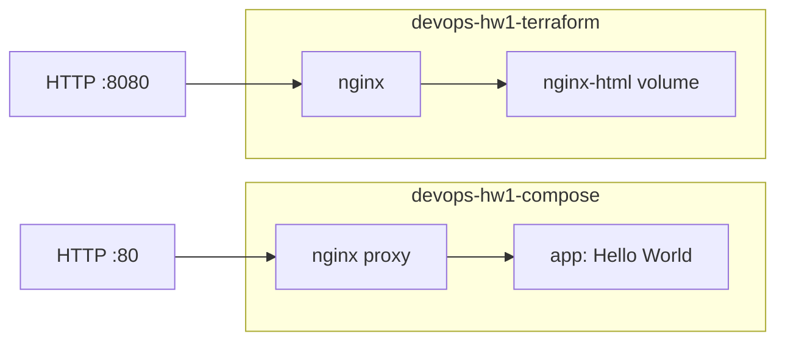

# ДЗ №1: фундамент DevOps-инфраструктуры

Киреев Дмитрий Владимирович, `kireevdv`. Ubuntu 24.04.4, сервер `111.88.162.109`.

Порядок настройки: **Ansible → Terraform → Docker Compose**.

- Ansible устанавливает Docker и Compose, создаёт `deployer` с SSH-ключом и sudo, настраивает мониторинг.
- Terraform с провайдером `kreuzwerker/docker` создаёт nginx на порту **8080**, отдельную сеть и именованный том.
- Compose запускает reverse proxy на порту **80** и приложение **Hello World** в другой сети.

## Архитектура



Сети разделены согласно уточнению задания. App доступен только через proxy; именованный том сохраняет страницу Terraform nginx при пересоздании контейнера. Используется выданный сервер.

## Запуск

Команды выполняются на сервере от `student` с sudo:

```bash
git clone https://github.com/jaruccky/devops-homework.git
cd devops-homework
bash scripts/setup_local.sh
```

Затем [установите Terraform и разверните контейнеры](docs/server-setup.md#terraform). Полный порядок запуска и проверки — в [инструкции](docs/server-setup.md).

## Результаты

| Проверка | Результат | Вывод |
|---|---|---|
| Повторный Ansible | `changed=0`, `failed=0` | [PNG](screenshots/ansible-second.png) |
| Terraform | 4 ресурса, повторный план `No changes` | [State](screenshots/terraform-state.png), [plan](evidence/terraform-repeat-plan.txt) |
| HTTP :8080 | `200 OK`, Welcome to nginx | [PNG](screenshots/terraform-curl.png) |
| HTTP :80 | `200 OK`, Hello World | [PNG](screenshots/compose-curl.png) |
| Контейнеры и сети | 3 healthy, сети разделены, том подключён | [Compose ps](screenshots/compose-ps.png), [проверка](evidence/networks.txt) |
| Мониторинг | Docker active, ошибок за час: 0 | [PNG](screenshots/monitor-server.png) |

PNG содержат сохранённые выводы команд. Полные транскрипты: [Terraform](evidence/terraform-server.txt), [Compose](evidence/compose-server.txt).

## Файлы проекта

- `ansible/` — настройка сервера и развёртывание Compose.
- `terraform/` — nginx, сеть, том и lock file провайдера.
- `compose/` — proxy, приложение и HTML.
- `scripts/` — установка, мониторинг и проверки.
- `evidence/`, `screenshots/` — результаты проверок.

Terraform state хранится на сервере в `/opt/devops-hw1-terraform/`, команды Terraform выполняются от `deployer`. State, пароли и приватные ключи исключены из Git.

[PR #1](https://github.com/jaruccky/devops-homework/pull/1) · [Само-ревью](docs/self-review.md)
